# Fernly — tableau de bord CRM commercial

Tableau de bord CRM pour une équipe commerciale, dans un style **vert « verre fumé »** : une barre latérale en dégradé vert foncé avec un onglet actif qui se fond dans le panneau blanc, des KPI avec mini-courbes, une bande d'insights, un graphique « Revenue vs target », une jauge de prévision trimestrielle, et des pages Reports, Tasks, Deals, Contacts, Calendar et Settings qui fonctionnent toutes.

**🔗 Démo en ligne : https://fernly-crm-dashboard.vercel.app**

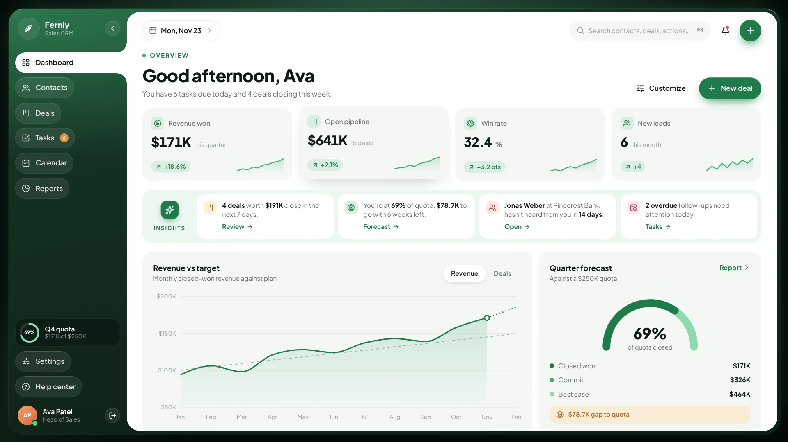

| Reports | Tasks | Deals (pipeline) |
|---|---|---|
| 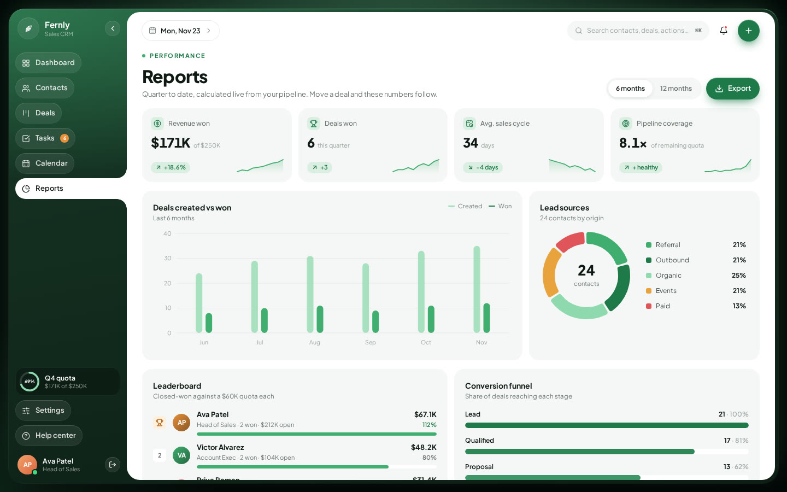 | 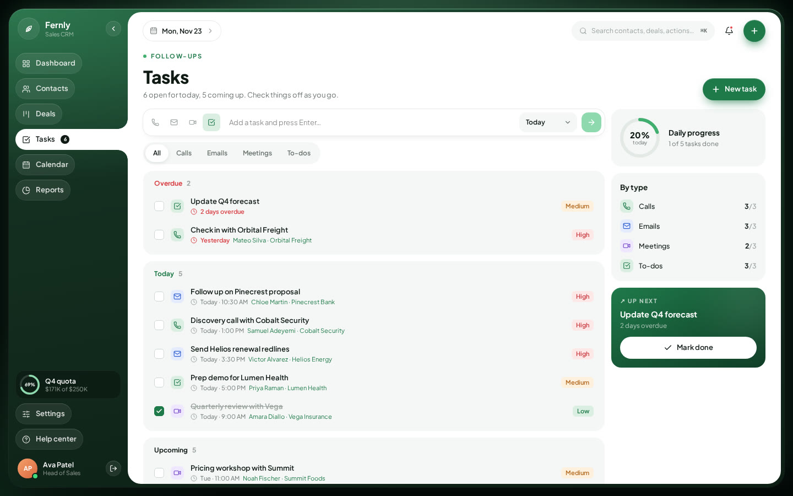 | 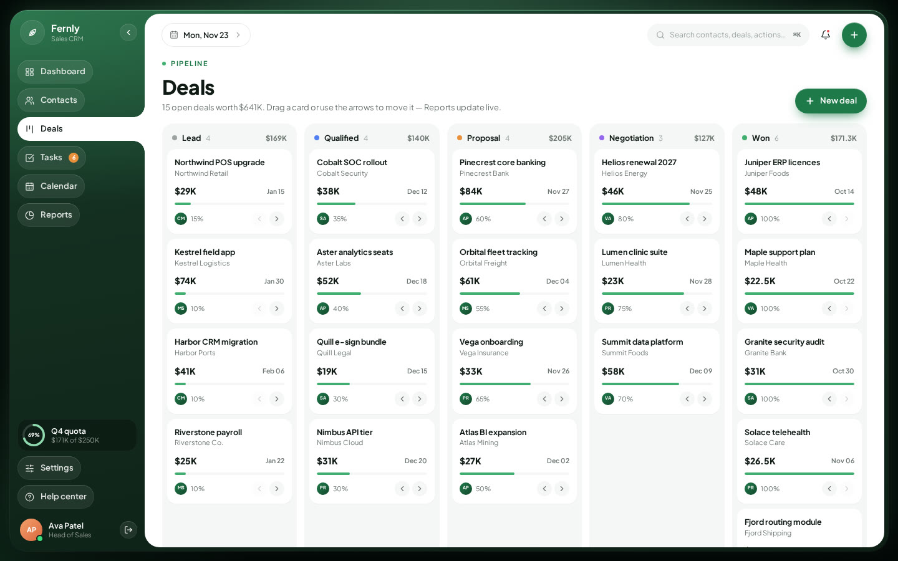 |

| Contacts | Calendar | Settings (accents) |
|---|---|---|
| 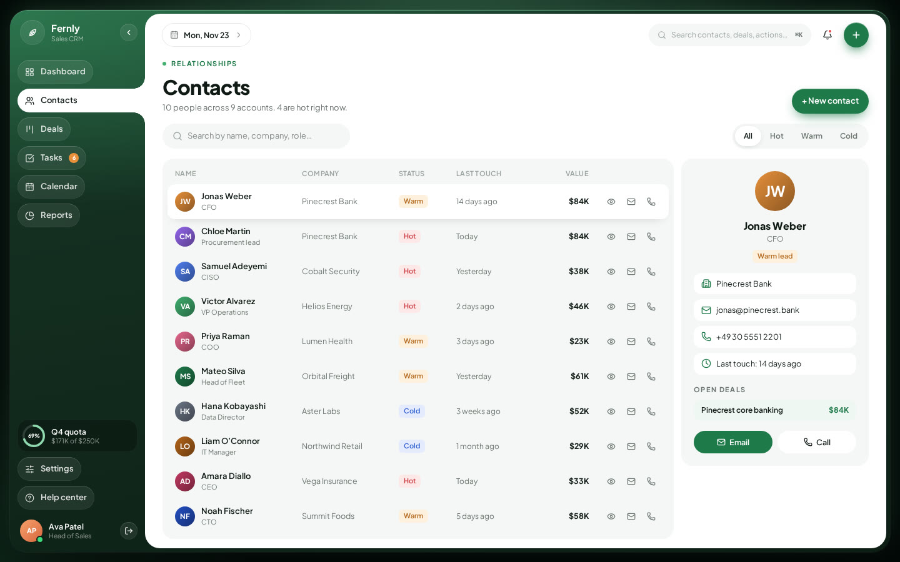 | 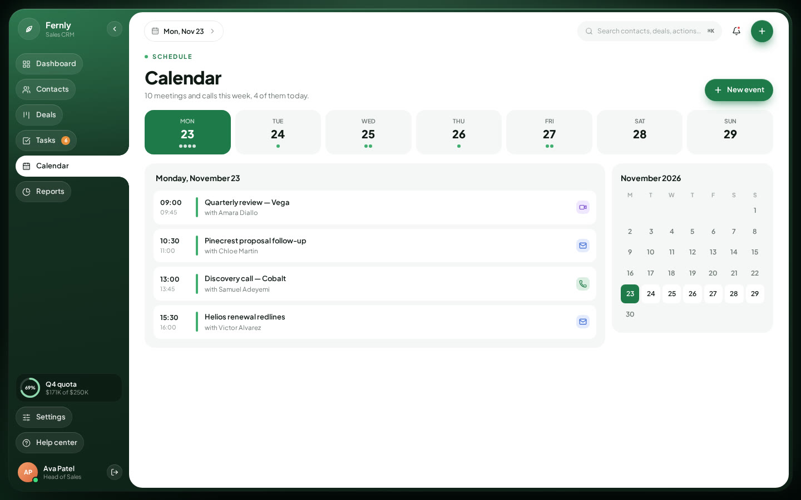 | 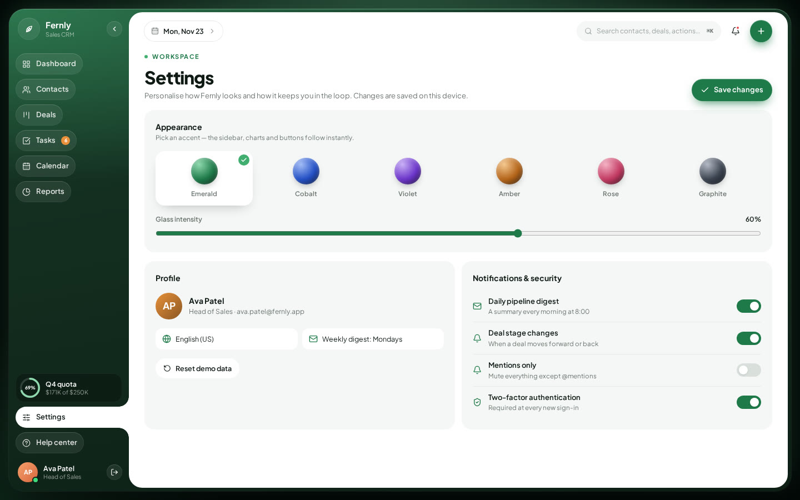 |

| Customize | Recherche ⌘K | Tablette |
|---|---|---|
| 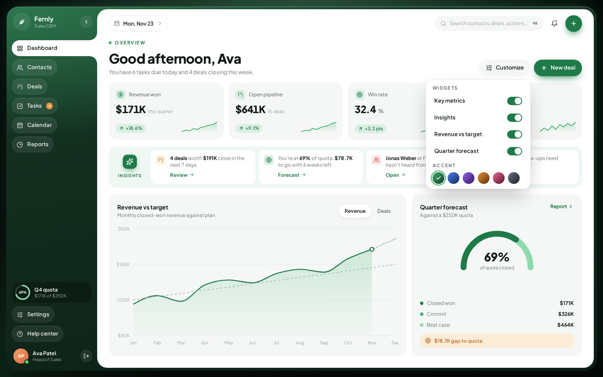 | 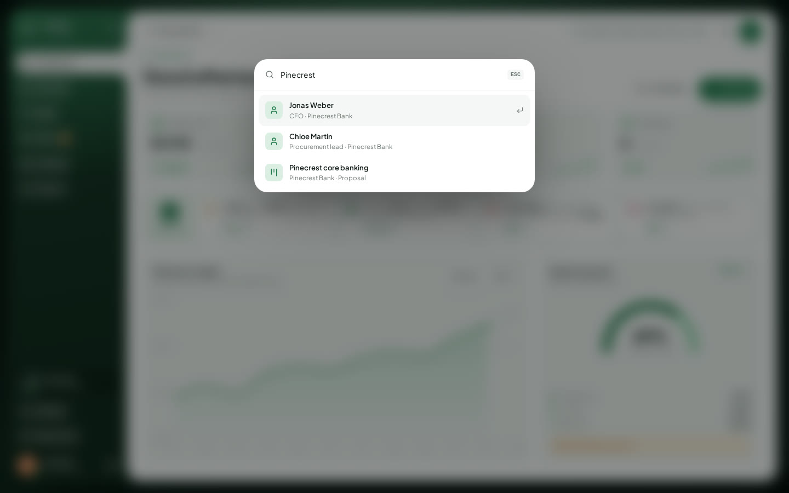 | 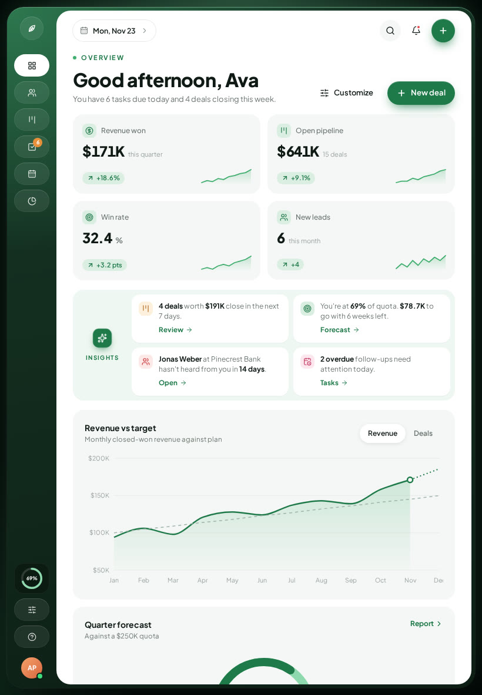 |

### Mobile (390 px)

| Dashboard | Reports | Tasks | Menu |
|---|---|---|---|
| 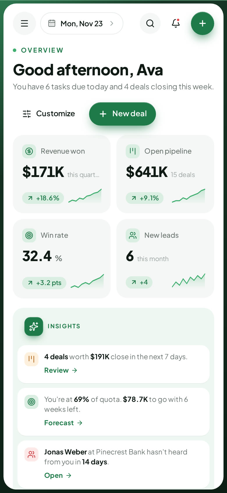 | 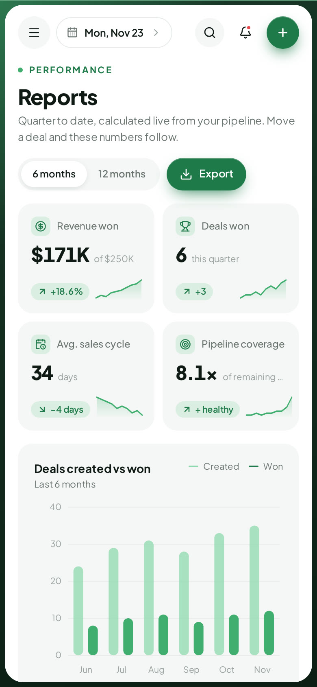 | 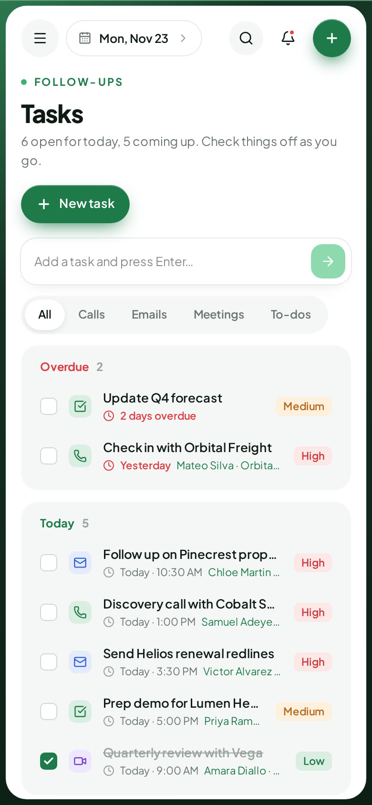 | 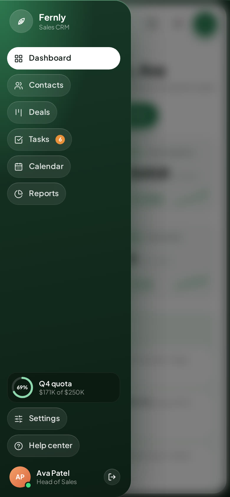 |

🎬 Vidéo de démonstration (1920×1080, 30 i/s) : [`video/fernly-crm-demo-1920x1080.mp4`](video/fernly-crm-demo-1920x1080.mp4)

## Fonctionnalités

- **Barre latérale en verre** : des pilules translucides, un onglet blanc qui **glisse** d'une page à l'autre et se raccorde au panneau par des coins inversés, un mode réduit (icônes seules) avec infobulles, un anneau « Q4 quota », le profil et la déconnexion.
- **Entrée animée** : le panneau passe du flou au net, la barre latérale s'ouvre, puis le contenu arrive en cascade de haut en bas.
- **Changement de page** : un squelette de chargement scintille un instant, puis la page apparaît avec un effet de flou.
- **Dashboard** :
  - 4 KPI avec compteurs animés, mini-courbes qui se dessinent et cartes qui se soulèvent au survol ;
  - une bande « Insights » cliquable ;
  - un graphique « Revenue vs target » qui bascule entre Revenue et Deals, avec une ligne d'objectif en pointillés et une prévision pour décembre ;
  - une jauge « Quarter forecast » ;
  - un panneau « Customize » pour masquer ou afficher les widgets et changer l'accent.
- **Reports** :
  - le chiffre d'affaires, les deals gagnés, le cycle de vente et la couverture du pipeline sont **calculés à partir du pipeline** ;
  - des barres « created vs won » sur 6 ou 12 mois ;
  - un donut « Lead sources » interactif ;
  - un classement des commerciaux, un entonnoir de conversion et un **export CSV**.
- **Tasks** :
  - un ajout rapide (type, échéance, touche Entrée), des filtres par type et des tâches à cocher ;
  - les groupes En retard, Aujourd'hui et À venir ;
  - un anneau de progression du jour, un décompte par type et une carte « Up next » avec un bouton « Mark done ».
- **Deals** : un pipeline Kanban en 5 étapes. On déplace une carte par **glisser-déposer** ou avec les flèches, et le Dashboard, Reports et le quota se mettent à jour tout de suite.
- **Contacts** :
  - une recherche et des filtres Hot, Warm et Cold ;
  - des actions Voir, E-mail et Appeler, avec infobulles ;
  - une fiche détaillée avec les deals liés.
- **Calendar** : une semaine en cours cliquable, l'agenda du jour et un mini-calendrier du mois.
- **Settings** :
  - **6 accents** (Emerald, Cobalt, Violet, Amber, Rose, Graphite) qui recolorent toute l'interface, barre latérale comprise ;
  - un réglage d'intensité du verre ;
  - des notifications et la réinitialisation des données de démo.
- **En haut de l'écran** :
  - une recherche globale **⌘K / Ctrl K** dans les pages, les contacts et les deals ;
  - des notifications ;
  - un menu « + » (nouveau deal, tâche ou contact) et une fenêtre « New deal ».
- **Responsive** : 1440 px, tablette (barre réduite) et mobile 390 px (menu en tiroir). Les animations se réduisent si l'utilisateur le demande (`prefers-reduced-motion`).
- Les données de démo restent dans le navigateur (`localStorage`).

## Stack

- [React 19](https://react.dev) + TypeScript, avec [Vite](https://vite.dev)
- [Tailwind CSS 4](https://tailwindcss.com), dont les couleurs d'accent passent par des variables CSS
- [Motion](https://motion.dev) pour les animations (layoutId, flou en cascade, pathLength, springs)
- [Recharts](https://recharts.org) pour les graphiques en aire, en barres et en donut
- [lucide-react](https://lucide.dev) pour les icônes, et la police Plus Jakarta Sans
- Le site est hébergé sur [Vercel](https://vercel.com)

## Lancer le projet

```bash
git clone https://github.com/Donchaminade/fernly-crm-dashboard.git
cd fernly-crm-dashboard
npm install
npm run dev      # http://localhost:5173
npm run build    # build de production dans dist/
```

Les pages sont dans `src/pages/`, la coque (barre latérale, en-tête et fenêtres) dans `src/components/`, et les données de démo dans `src/data.ts`.

## Crédits

Ce design s'inspire du reel « CRM Dashboard V10 » de [@code.xr](https://www.instagram.com/code.xr/). Il a été recréé de zéro en React, Tailwind, Motion et Recharts, sous un nom et un logo originaux (Fernly). Les personnes et entreprises affichées sont fictives.

## ⭐ Star & Fork

Si ce projet t'est utile ou t'inspire, **laisse une ⭐ Star** et **fais un Fork** pour l'adapter à ton CRM ou à ton back-office.
Les retours et les PR sont les bienvenus !

---

Licence [MIT](LICENSE) — © 2026 Donchaminade
